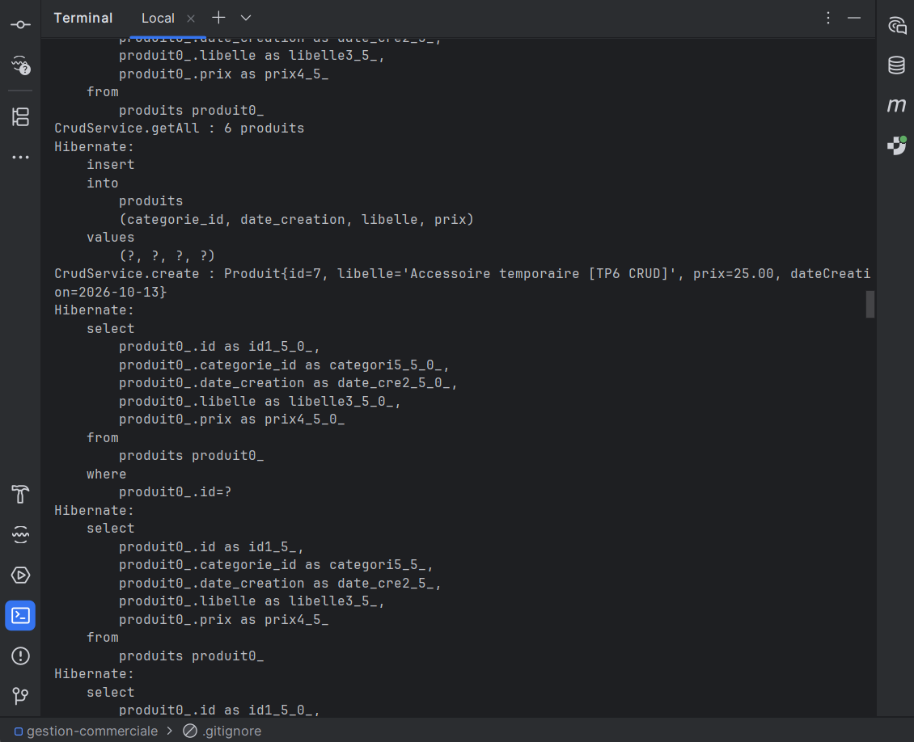
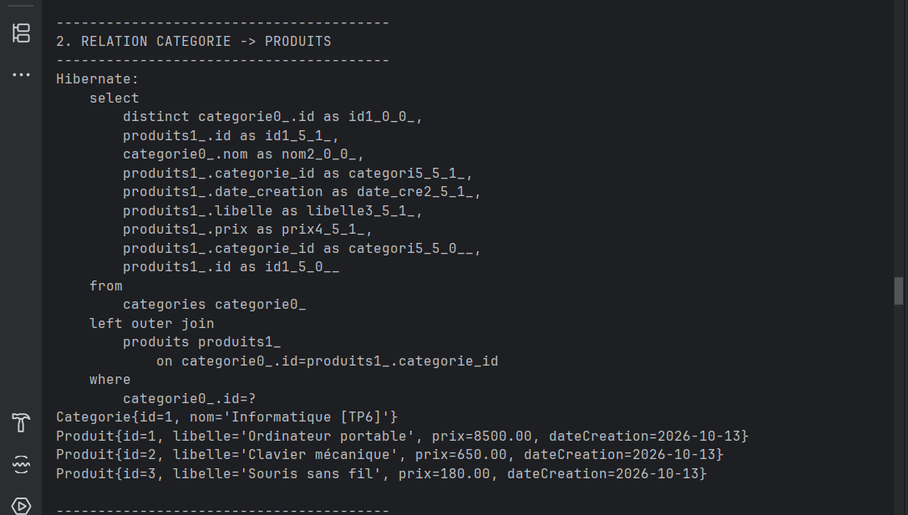
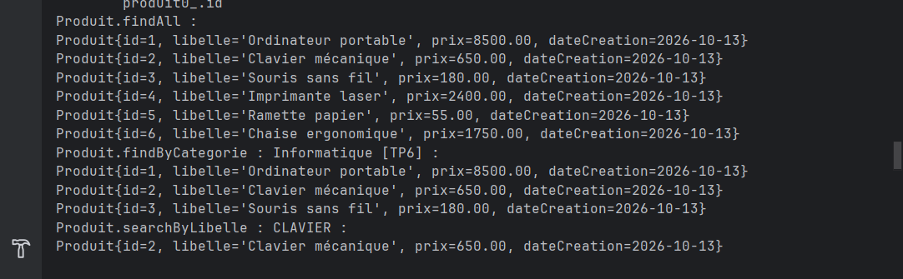
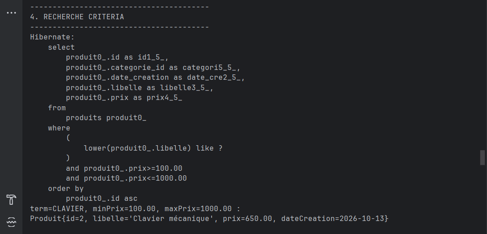
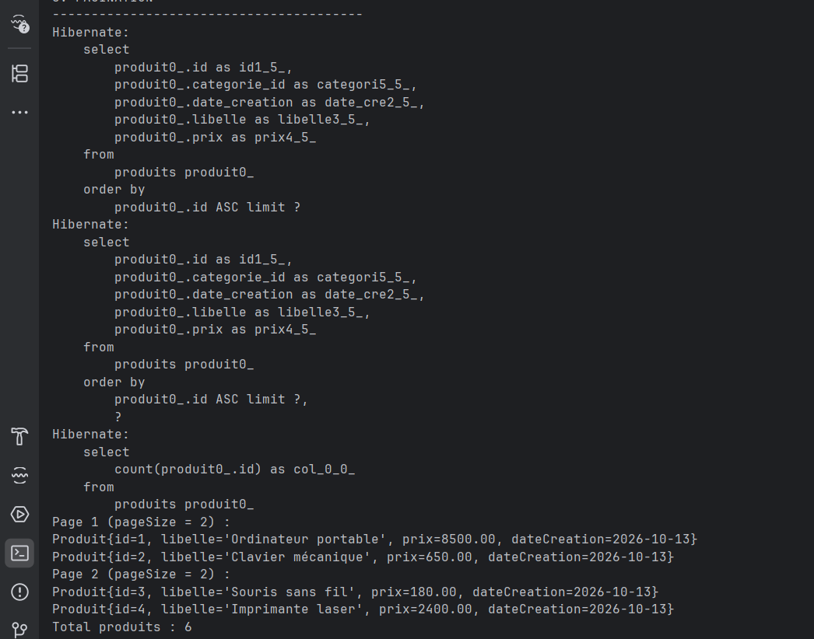
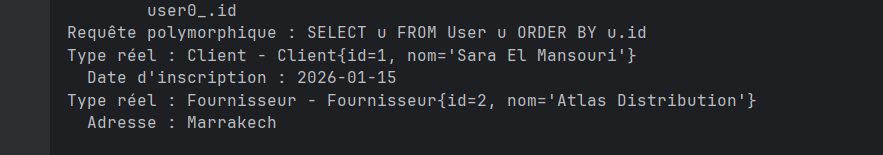
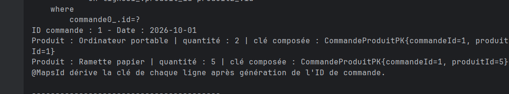
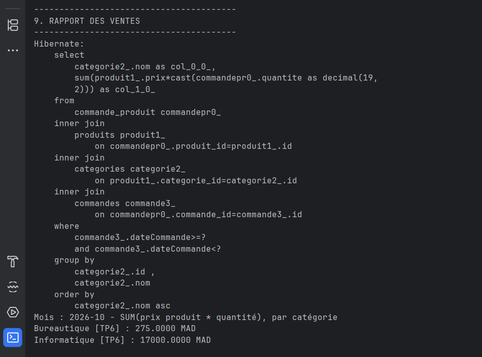
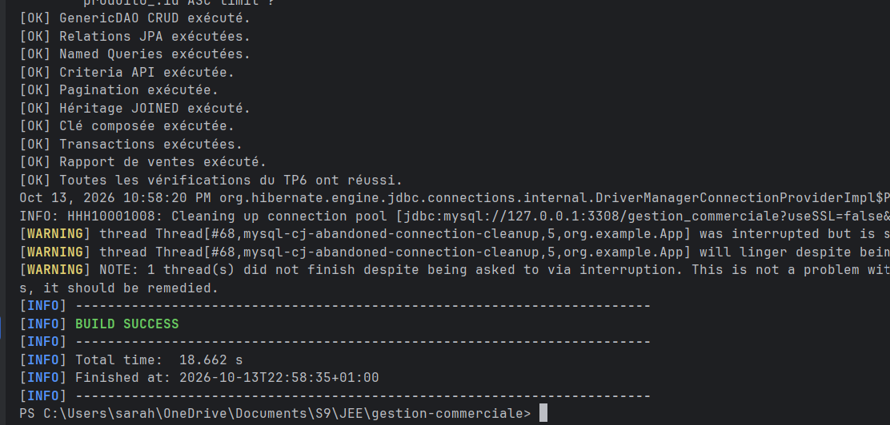

# TP6 - Gestion commerciale avec JPA et Hibernate

Ce projet met en pratique Hibernate/JPA, le GenericDAO, les relations JPA, les Named Queries, Criteria API, la pagination, l’héritage JOINED, les clés composées et un rapport de ventes.

## Captures d’écran

### 1. GenericDAO et opérations CRUD

Exécution des principales opérations CRUD à travers le GenericDAO et le service générique.

---

### 2. Relation Catégorie - Produits

Vérification de la relation bidirectionnelle entre une catégorie et ses produits.

---

### 3. Named Queries

Exécution des Named Queries pour récupérer les produits et effectuer une recherche par libellé.

---

### 4. Recherche avec Criteria API

Recherche dynamique de produits selon plusieurs critères comme le libellé et l’intervalle de prix.

---

### 5. Pagination

Pagination des produits avec `setFirstResult` et `setMaxResults`.

---

### 6. Héritage JOINED

Requête polymorphique sur la hiérarchie `User`, `Client` et `Fournisseur` utilisant la stratégie JOINED.

---

### 7. Clé composée

Gestion de la relation entre commandes et produits avec une entité associative et une clé composée.

---

### 8. Rapport des ventes

Calcul du chiffre d’affaires par catégorie à partir du prix des produits et des quantités commandées.

---

### 9. Validation finale

Validation finale du TP6 avec toutes les fonctionnalités exécutées avec succès et un `BUILD SUCCESS`.

## Résultat

Toutes les fonctionnalités principales du TP6 ont été exécutées et validées avec succès.
